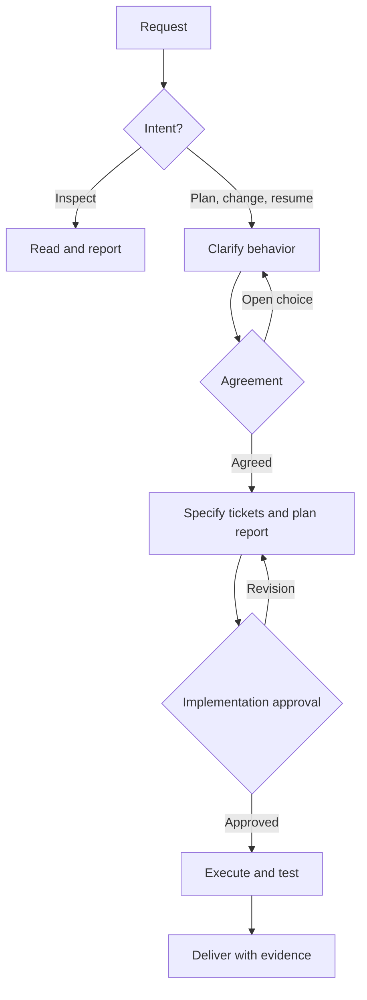

# Workflow AXA in one page

The purpose is to turn a software request into understood behavior, a visible plan, verified code, and a short handoff. `/workflow` is a **router**, not a second copy of every specialist. Use the smallest route that covers the risk.

## What happens when you ask

| Your intent | What the agent does | What it must not do |
|---|---|---|
| Explain, investigate, review, audit | Read the relevant code and evidence; answer | Create task files, demand implementation approval, change the application |
| Plan a change | Discover related task records, trace behavior, ask missing decisions, agree behavior, prepare a visual plan | Write application code or treat a suggestion as your approval |
| Change software | Follow agreement and plan approval for substantive changes; implement tested tickets | Guess an irreversible choice, broaden scope, commit/publish unasked |
| Resume old work | Read current code and records; reconcile scope, approvals, pending checks | Start a duplicate task, assume a draft report is approved |
| Tiny exact edit | State the minimal files and verification; use the documented lightweight route when risk permits | Reclassify a visible behavior change as “tiny” to skip approval |

## One orchestrator, four owned phases

- `workflow` owns **routing** and applies the shared policies. It must not paraphrase the full other skills into its own SKILL.md.
- `workflow-clarify` owns **questions and behavior agreement**. It reads current callers and failure journeys first. `grilling` identifies consequential decisions and tests the agreement against awkward cases; it is allowed to ask *zero* questions when evidence and user words settle them.
- `workflow-specify` owns **tickets, checks and the plan report**. Keep a small change to one ticket when that is enough. A multi-layer user journey may need a vertical ticket; do not create bookkeeping tickets only to satisfy a template.
- `workflow-execute` owns **application edits, TDD and code review**. Run the checks that match the change, repair after feedback, and rerun affected checks after the final edit. The TDD loop includes refactoring after green when it is worthwhile.
- `workflow-deliver` owns **evidence and handoff**. “Implemented,” “tested,” “reviewed,” and “human accepted” are different facts. Report blocked or unverified work honestly.

The source-of-truth is the existing task folder: `PLAN.md` (scope/authority), `TODO.md` (tickets), `FINDINGS.md` (evidence), and `DECISIONS.md` (choices/reasons). The HTML/JSON report is a **dated snapshot**, not a live database or an approval button. A later status belongs in those records, not edits to a previously shown report.

## Which specialist is used?

| Need | Owner | When to load it |
|---|---|---|
| Code flow or report | `codebase-map` | Diagram requests, plan and delivery reports |
| UI selection / component reuse | `ui-design` | Application screen changes; stop if the existing kit cannot express the request |
| Undecided behavior | `grilling` through `workflow-clarify` | After reading existing code and known decisions |
| Architecture owner/interface | `codebase-design` / `domain-modeling` | A seam, responsibility or term is genuinely disputed |
| Build tests | `tdd` | An approved ticket has testable behavior |
| Verify code and standards | `code-review` | A changed diff, not another identical review |
| Rules and host readiness | `rule-maker` / `workflow-doctor` | Missing or changed rules, installation and duplicate-copy diagnosis |
| Status after interruption | `resume-task` / `task-status` | Existing work, never an invented clean slate |

Pinned vendored specialists live with the plugin; optional external specialists may block only their dependent phase. `implement-spec` is an upstream reference, not a second executable orchestration flow. No skill may grant tool/file permissions by describing them.

## Keep it proportional

1. **Inspect without paperwork.** A “why does this fail?” question is not an implementation order. A later “fix it” enters the approval route.
2. **Ask only impactful unknowns.** First settle facts with code, tests and docs. For material choices, show options, a recommendation and consequences; save the question before sending it. Do not grill for aesthetic preferences when no UI is changing.
3. **Approve what can be seen.** Agreement confirms behavior; implementation approval confirms tickets, test strategy and the complete plan report. When a small change has no open choice, show both together in one user-facing decision. Do not require a new approval for an in-scope test rerun.
4. **Show real visuals.** The report shows current/proposed flows and error branches. For visible UI changes, select actual components/variants from the project's live kit and show a screen flow. The report renderer's own HTML/CSS is *only* for reporting; it does not give permission to design application CSS.
5. **Check on the right surface.** Unit and integration tests for functional behavior; device/browser or human verification only when the acceptance condition needs it. A failing pre-existing baseline must be separated from a new regression.
6. **Resume without asking twice.** Preserve approvals for the exact unchanged scope and detect partial code/test work. A provisional identity checkpoint exists because the team once lost that question across sessions; it is not permission to implement.

## Reduce copied report content

The installable package includes `skills/codebase-map/scripts/record_projection.py`: optional `heading:` and `ticket:` locators can freeze existing Markdown prose into a **new draft** JSON, then `--check` verifies that the draft still matches the source. Other report fields, diagrams and approval state remain authored/reviewed. See [TASK-REPORT.md](../skills/codebase-map/TASK-REPORT.md).

## What enforces the contract?

Claude Code's installed hooks check several approval and write patterns after activation, with known gaps for indirect shell/MCP writes. Codex currently relies on its host permissions and the instructions; this repo has no equivalent Codex hook. Keep application Git permissions, CI, code review and human approval in the engineering process; don't claim an instruction is a security sandbox.

For release quality, see [EVALUATION.md](EVALUATION.md). For a quick start, see the repository [README](../README.md); long upgrade history lives in CHANGELOG and UPGRADE.
