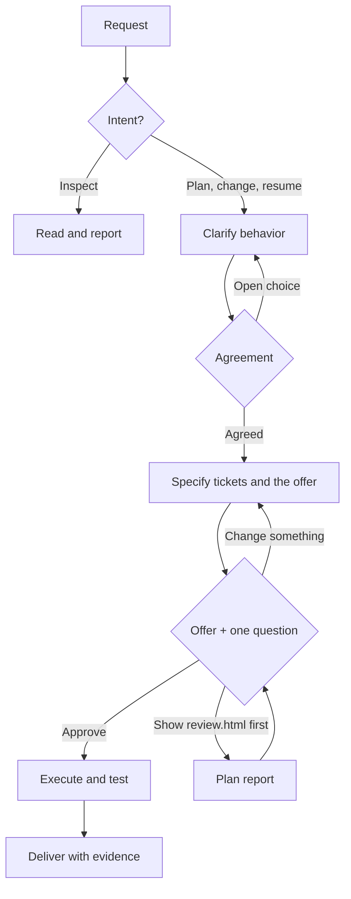

# Workflow AXA in one page

The purpose is to turn a software request into understood behavior, a visible plan, verified code, and a short handoff. `/workflow` is a **router**, not a second copy of every specialist. Use the smallest route that covers the risk.

## What happens when you ask

| Your intent | What the agent does | What it must not do |
|---|---|---|
| Explain, investigate, review, audit | Read the relevant code and evidence; answer | Create task files, present an offer, change the application |
| Plan a change | Discover related task records, trace behavior, ask missing decisions, agree behavior, prepare the offer | Write application code or treat a suggestion as your approval |
| Change software | Follow the agreement, then present the offer and ask the one question; implement tested tickets after your answer approves it | Guess an irreversible choice, broaden scope, commit/publish unasked |
| Resume old work | Read current code and records; reconcile scope, offers, approvals, pending checks | Start a duplicate task, assume an offer is approved without your answer |
| Tiny exact edit | Present the minimal offer: its files, its check and a one-line why | Reclassify a visible behavior change as “tiny” to shrink the offer |

## One orchestrator, four owned phases

- `workflow` owns **routing** and applies the shared policies. It must not paraphrase the full other skills into its own SKILL.md.
- `workflow-clarify` owns **questions and behavior agreement**. It reads current callers and failure journeys first. `grilling` identifies consequential decisions and tests the agreement against awkward cases; it is allowed to ask *zero* questions when evidence and user words settle them.
- `workflow-specify` owns **tickets, checks, the offer and the one question**, and the plan report when the owner asks for it. Keep one-ticket work to one ticket when that is enough. A multi-layer user journey may need a vertical ticket; do not create bookkeeping tickets only to satisfy a template.
- `workflow-execute` owns **application edits, TDD and code review**. Run the checks that match the change, repair after feedback, and rerun affected checks after the final edit. The TDD loop includes refactoring after green when it is worthwhile.
- `workflow-deliver` owns **evidence and handoff**. “Implemented,” “tested,” “reviewed,” and “human accepted” are different facts. Report blocked or unverified work honestly.

The source-of-truth is the existing task folder: `PLAN.md` (scope/authority), `TODO.md` (tickets), `FINDINGS.md` (evidence), and `DECISIONS.md` (choices/reasons). The HTML/JSON report is a **dated snapshot**, not a live database or an approval button. A later status belongs in those records, not edits to a previously shown report.

## Which specialist is used?

| Need | Owner | When to load it |
|---|---|---|
| Code flow or report | `codebase-map` | Diagram requests, plan and delivery reports |
| UI selection / component reuse | `ui-design` | Application screen changes: reuse the existing kit first; with the CSS switch on and the project's DESIGN.md allowing it, styling within the approved offer; otherwise ask which existing element to mimic |
| Undecided behavior | `grilling` through `workflow-clarify` | After reading existing code and known decisions |
| Architecture owner/interface | `codebase-design` / `domain-modeling` | A seam, responsibility or term is genuinely disputed |
| Build tests | `tdd` | An approved ticket has testable behavior |
| Verify code and standards | `code-review` | A changed diff, not another identical review |
| Rules and host readiness | `rule-maker` (audit, diagnose) | Missing or changed rules, installation and duplicate-copy diagnosis |
| Status after interruption | `resume` (status, continue, handoff) | Existing work, never an invented clean slate |

The bundled specialists are skills of this package and live with the plugin. Optional external specialists are named in `skills/workflow/SPECIALISTS.md`; they are checked only when a step needs one and may block only that step. No skill may grant tool/file permissions by describing them.

## Keep it proportional

1. **Inspect without paperwork.** A “why does this fail?” question is not an implementation order. A later “fix it” enters the approval route.
2. **Ask only impactful unknowns.** First settle facts with code, tests and docs. For material choices, show options, a recommendation and consequences; save the question before sending it. Do not grill for aesthetic preferences when no UI is changing.
3. **Approve what can be seen.** Agreement confirms behavior; the owner's answer to the one question approves the offer: its behavior summary, paths, protected operations, exclusions and checks. One-ticket work with no open choice carries its agreement in the offer. Do not require a new approval for an in-scope test rerun.
4. **Show real visuals.** When the owner asks for the plan report, it shows current/proposed flows and error branches. For visible UI changes, select actual components/variants from the project's live kit and show a screen flow. The report renderer's own HTML/CSS is *only* for reporting; it does not give permission to design application CSS.
5. **Check on the right surface.** Unit and integration tests for functional behavior; device/browser or human verification only when the acceptance condition needs it. A failing pre-existing baseline must be separated from a new regression.
6. **Resume without asking twice.** Preserve approvals for the exact unchanged scope and detect partial code/test work. A provisional identity checkpoint exists because the team once lost that question across sessions; it is not permission to implement.

## Reduce copied report content

The installable package includes `skills/codebase-map/scripts/record_projection.py`: optional `heading:` and `ticket:` locators can freeze existing Markdown prose into a **new draft** JSON, then `--check` verifies that the draft still matches the source. Other report fields, diagrams and approval state remain authored/reviewed. See [TASK-REPORT.md](../skills/codebase-map/TASK-REPORT.md).

## What enforces the contract?

Claude Code runs the hooks registered in `hooks/hooks.json`, with known gaps for indirect shell/MCP writes:

| Event | Hook | What it does |
|---|---|---|
| PreToolUse (writes, Bash, PowerShell, Skill, MCP write tools) | `approval.py` | Allows a project write only inside an approved offer's paths and named operations; reads the owner's answer from the conversation; refuses styling while the CSS switch is off; keeps offer records, the switch and the legacy inventory out of direct writes; refuses `git clean`, bulk deletes of `.artifacts` and unrequested installs. A task in the legacy inventory goes through `phase_gate.py`'s Approval-line check. |
| PostToolUse, UserPromptSubmit | `phase_gate.py` | The legacy checker and shared library (parsing, kept safeguards, read checks); these two hooks keep its fingerprints for legacy tasks. |
| SessionStart | `duplicate_skills.py` | Names second copies of workflow-axa skills and explains how to settle them; never blocks. |

`hooks/read_evidence.py` is a library for the required-read check, not a hook. There is no Stop hook: delivery runs `skills/workflow-deliver/scripts/completion_check.py`, which needs a review of the exact bytes of every changed path before Done. The router picks a recipe from `skills/workflow/flows/`, and `skills/workflow/FALLBACKS.md` names what to do when a tool or check is missing. [RULE-CONTRACTS.md](RULE-CONTRACTS.md) lists what checks each hard rule and the remaining hook candidates. Codex currently relies on its host permissions and the instructions; this repo has no equivalent Codex hook. Keep application Git permissions, CI, code review and human approval in the engineering process; don't claim an instruction is a security sandbox.

For release quality, see [EVALUATION.md](EVALUATION.md). For a quick start, see the repository [README](../README.md); long upgrade history lives in CHANGELOG and UPGRADE.
