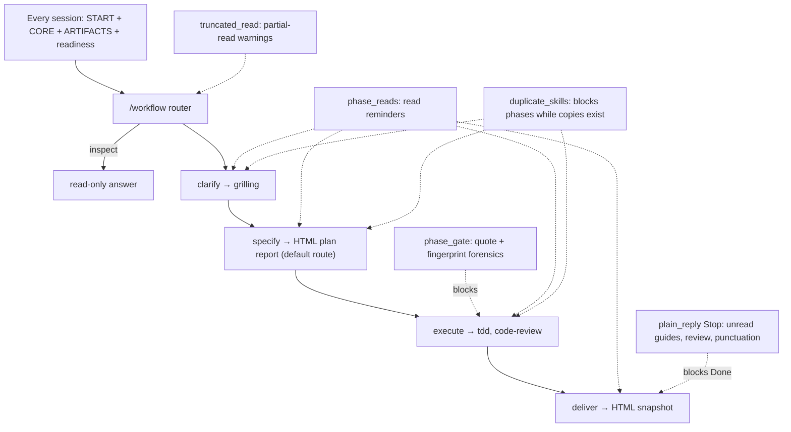
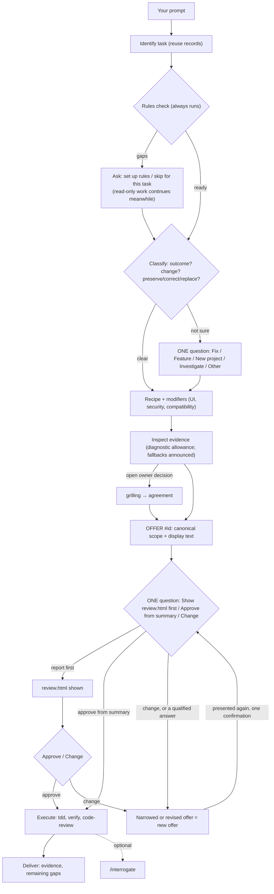

# workflow-axa: full review and redesign plan

**Version:** v6, agreed by both models in rounds 15–17 (your changes: one CSS switch per machine, how flows are defined), on top of v5, which both models agreed section by section in rounds 12–14: v4 (approved by both models after 11 rounds) plus your latest additions: §3.9 comments, §3.10 `/wait-what`, the reasons for the merges in §6, and more pstack / Matt Pocock adoptions in §12. v2 is kept as `FULL-PLAN-v2.md`.
**Candidate reviewed:** 2.8.0-rc.39, rules 1.8.8. No repository file was changed.
**Status:** **ready for your approval.** Every row below says Agree / Agree (round 17). Nothing is implemented until you approve. Two decisions are open in §18.

---

## Agreement per section

A section is **ready** only when both models agree. Rounds continue until every row says Agree / Agree.

| § | Section | Opus | Astra | Round |
|---|---|---|---|---|
| S | Simple version (SIMPLE-PLAN.md) | Agree | Agree | 16 |
| 1 | Executive summary | Agree | Agree | 15 |
| 2 | Current architecture and problems | Agree | Agree | 12 |
| 3 | Target architecture (incl. offer, one question, rules, CSS switch, interrogate) | Agree | Agree | 17 |
| 3.9 | Comments: code is the truth, `/no-comments` (new) | Agree | Agree | 14 |
| 3.10 | `/wait-what` (new) | Agree | Agree | 13 |
| 4 | Recipes (incl. 4.0 how flows are defined) | Agree | Agree | 16 |
| 5 | Fallbacks and what may pause work | Agree | Agree | 13 |
| 6 | Every skill (now 19, merge reasons) | Agree | Agree | 15 |
| 7 | Hooks | Agree | Agree | 17 |
| 8 | Rules library | Agree | Agree | 16 |
| 9 | Scripts | Agree | Agree | 16 |
| 10 | Docs | Agree | Agree | 12 |
| 11 | Tests and tools | Agree | Agree | 17 |
| 12 | External research (extended) | Agree | Agree | 13 |
| 13 | Scenarios | Agree | Agree | 15 |
| 14 | Implementation checkpoints | Agree | Agree | 16 |
| 15 | Validation | Agree | Agree | 16 |
| 16–18 | Sparring summary, statements, your decisions | Agree | Agree | 16 |

## 1. Executive summary (plain English)

**What works and stays.** Your quality comes from a few habits, and everything here protects them:
- read the code and its callers before changing anything;
- reproduce bugs;
- write tests first at real seams;
- have a separate reviewer check both "does it meet our standards" and "does it do what we agreed";
- report honestly what was and wasn't verified;
- ask you only about real open decisions.

**What's wrong.** A heavy enforcement layer grew on top of those habits:
- **Approval is proven by forensics.** A 2,655-line hook re-reads the conversation and checks exact quotes, report fingerprints and revision numbers. In your real session, one plan took 3 approval messages from you and another took 4. The reasons: you wrote "no need for report" instead of "no report", and a plan message didn't contain the text "r4".
- **The default route needs an HTML report for every approval**, even a one-line fix. Only narrow exceptions exist.
- **The CSS ban is repeated across the rule library and has no supported way to switch it off.** Even you, the designer, can't lift it, and behaviour drifts between the copies.
- **One process for every task.** There's no recipe for performance work or migrations, and no defined "I'm not sure what this is, so I'll ask".
- **Supporting machinery adds friction.** Hooks police reading habits and punctuation. The validator hard-codes skill and file lists, and docs cite line numbers. Adding one skill or one reference file touches many places.

**What changes.**
1. **One process for every task, with short recipes per kind of task.** The AI picks the recipe. If it's not sure, it asks you one question with four buttons (Fix something broken / Add or change a feature / Start a new project / Only investigate) plus Other.
2. **Named fallbacks.** When something is missing, the agent says in one line what it does instead and what stays unproven, and continues. Only six things may pause the dependent work (§5).
3. **One way to approve: an "offer" with one question.** The agent shows what changes, where, what's excluded and which checks run, under an offer number. It then asks one question with three answers: **Show review.html first · Approve from this summary · Change something**. Small changes included: nothing is assumed. There's no exact-quote matching.
4. **Rules are always asked about, never a wall.** If project rules are missing or weak, the agent asks "Set up rules now / Skip for this task". Skipping waives only what's missing; existing rules still apply.
5. **CSS is one switch.** `~/.workflow-axa/settings.json` says `"css": "off"` (default) or `"on"`, read by every agent on that machine (§3.6). Projects can only be stricter.
6. **Less machinery.** Three hooks are removed and the approval hook is rebuilt as a small offer checker. 21 skills become 19, which includes the new `/interrogate`, `/no-comments` and `/wait-what`. The validator reads the plugin manifest, so adding a skill touches 2–3 files.
7. **Done as one approved redesign.** It's built in 8 checkpoints, starting with your real session as regression tests. Only protected steps need a separate OK: global installs, pushes, and paid live tests within a budget you set.

---

## 2. Current architecture: what exists and how it connects

### 2.1 Inventory

| Area | Contents | Size |
|---|---|---|
| Skills | 21 registered (§6) | ~36k words in workflow, phase, map and ui skills |
| Hooks | phase_gate, phase_reads, plain_reply, truncated_read, duplicate_skills | 3,721 lines (phase_gate 2,655) |
| Shared rules | 29 files in `skills/rule-maker/rules/` plus a SHA manifest | START + CORE + ARTIFACTS in every session (global CLAUDE.md) |
| Scripts | workflow 6, codebase-map 9, ui-design 5, rule-maker 6, retro 1 | ~8k lines (docs_check 1,430, render_report 1,065) |
| Tools | validate, verification_summary, build_release, browser/visual smoke, fixtures | ~2k lines |
| Docs | README, CONTEXT, ARCHITECTURE, RULE-CONTRACTS, DESIGN, EVALUATION, CHANGELOG (614 lines), UPGRADE, VALIDATION, VENDORED-SKILLS | — |
| Tests | 57 test files, behavioural case JSON, fixtures | 1,229 tests at rc.39 |

### 2.2 Execution path today

### 2.3 Confirmed problems

| ID | Problem | Evidence |
|---|---|---|
| P1 | The "no report" waiver recognises few phrasings: "no need for report", "without review.html" and "skip the report" all fail | `hooks/phase_gate.py:89`; offline test; session 00:01–00:21 |
| P2 | A waiver and a later "Approve" never combine (checked one quote at a time) | `phase_gate.py:1464,1498`; session transcript line 1373 |
| P3 | A plan counts as "shown" only if one message has "plan", the task path and a literal rN | `phase_gate.py:1226-1232`; session r4 at 01:06 |
| P4 | The default full route needs a fresh HTML report for every approval request. Exceptions: small change, lightweight edit, explicit waiver | `skills/workflow/VISUAL-REVIEW.md:21` |
| P5 | A small change needs a new "yes" in every new session | `VISUAL-REVIEW.md:32` |
| P6 | The gate reads write scope and fingerprints from HTML reports | `phase_gate.py:1843,1918,1953` |
| P7 | The active CSS prohibition is repeated in START, CORE, READINESS, DESIGN, ANGULAR, IONIC (CHANGES and SOURCES only mention it historically); there's no supported task-level grant | rule files |
| P8 | One fix needed 35 line citations remapped by hand | `docs/plans/2026-11-12-gate-followups/FINDINGS.md:38` |
| P9 | A blanket partial-read warning fires on legitimate inspection | `hooks/truncated_read.py` |
| P10 | The small route forbids new files (so no regression test) and any folder holding a report | `VISUAL-REVIEW.md:25`; `phase_gate.py:1796` |
| N1 | Generic refusal text led the agent to misdiagnose its own gate (it blamed a markdown link) | session 01:06:59 |
| N2 | The Stop hook demanded report guides on a no-report route | session 00:12:47 |
| N3 | Project required-reads apply to every task | session 00:01:31 |
| N4 | Writing another task's records counts as a task switch and blocks git | session 01:35, 01:38 |
| N5 | A write happened before a denial (agent disclosure; possible coverage gap) | session 01:06 |
| N6 | The owner said "no new branch"; the agent had created one. Whether it was authorised isn't yet correlated | session 01:35, 01:40 |
| G1 | `verification_summary.py` exits 0 even when tests or validate failed | `tools/verification_summary.py:160-203` |
| G2 | `validate.py` hard-codes the skill list inside a word-budget table | `tools/validate.py:19` |
| G3 | The required-read grammar is parsed in both docs_check and phase_gate | `docs_check.py:66`; `phase_gate.py:2211` |
| G4 | CONTEXT.md works as a parser registry (`_Avoid_` synonym bans enforced by validate) | `CONTEXT.md:3` |
| G5 | Every reference .md needs a hand-added budget line in validate.py, and `REQUIRED` hard-codes hooks and scripts, so adding or removing a file fails validation | `tools/validate.py:21-74,215` |

**Hypotheses, measured in checkpoint 1:** most elapsed time on small work goes to the report and approval recovery; screenshot or design steps on backend work come from misrouting.

---

## 3. Target architecture

### 3.1 The picture

### 3.2 One process for every change
**Identify task → rules readiness → inspect evidence → settle open decisions → offer → approve → implement → verify and review → deliver.**
Recipes add steps and evidence. They never add approval mechanisms. There are no separate "depth classes": the recipe and the evidence decide how much planning is done.

**Policy change (your instruction):** the old zero-question **lightweight edit** route ends. Every change, however small, gets an offer and the one three-answer question, because "a small change could also lead to big damage if overlooked". A lightweight edit (no observable behaviour, interface, dependency or security change) gets a **minimal offer**: files, the check, and a one-line why. It's still asked, never assumed. It keeps the short delivery and one review. The **small-change route** is absorbed into the normal one-ticket offer.

### 3.3 Choosing a flow (testable rules)
1. Extract three fields: the outcome you want; whether a change is requested; whether existing behaviour is preserved, corrected or replaced.
2. If they point to one recipe, take it and add modifiers: UI (anything on screen), security (auth, secrets, permissions), compatibility (saved data, public interfaces, versions).
3. **"Not sure"** means exactly one of:
   - two plausible flows need different behaviour, permissions or acceptance;
   - the outcome, or whether a change is wanted, isn't stated.

   Needing several references is not uncertainty.
4. Then ask **one** question through the host's question tool: **Fix something broken · Add or change a feature · Start a new project · Only investigate/explain**, recommended first with a one-line reason, plus Other. The recommendation is never consent. Small versus complex bug is never asked. At most one classification question per task.
5. **Other** with a clear outcome: the agent assembles steps from the common process. **Other** that's empty or vague: **Inspect-first**, then a grilling question if needed.
6. **Reclassification** is announced in one line with its evidence. Done work is kept. A new offer is needed only when the canonical scope changes, and only for the difference.

### 3.4 Approval: the offer model

**The offer object** (`record.py offer`, stored in the task folder):
- `id`, `task`, `workspace`, `conversation`, and `state`, which is one of:
  - `pending`;
  - `approved`;
  - `superseded` (replaced by a newer offer);
  - `revoked`.
- **Canonical fields:** the things that authorise. Behaviour summary, allowed paths and operations, explicitly delegable paths and operations (for children), exclusions, conditions, required checks, parent offer and parent provenance (for children).
- **Presentation decision** (separate from the canonical fields, so choosing a report never creates a new scope revision): `report: asked | html-first | chat`, bound to this offer id.
- **Display text:** wording shown to you. Editing display text never needs re-approval; any change to canonical fields creates a new offer that supersedes the old one.

**Presentation is explicit and verified, not guessed.** `record.py offer --present` prints a **canonical rendering** of **every** canonical field: behaviour, paths, operations, delegable scope, exclusions, conditions, checks, and parent reference, plus a short hash. Below it, a display-only line shows the current CSS setting; that line is excluded from the hash and from the byte-equality check, so switching CSS never invalidates an approval. The agent's own summary may sit around it but never replaces it. An offer becomes `pending` only with **successful presentation evidence**:
1. a question-tool call whose payload contains the canonical rendering **and** which completed with a real user answer (failed or cancelled calls don't count);
2. a visible assistant message containing the canonical rendering **byte-equal** to what the adapter re-renders from the stored offer (a mismatched or edited block doesn't count).

The adapter checks the most recent successful presentation of that id in this conversation. No keyword or regex heuristics. Which of the two works on each host is **established by the checkpoint 5 host tests**; until then, nothing is claimed universal.

**Structured approval is one atomic step.** A completed question call is both the presentation evidence and your answer. Selecting "Approve from this summary" for offer #<id> there approves it directly, with no further turn. Selecting "Show review.html first" records `html-first` and approves nothing yet. A cancelled or failed call is neither. A qualified answer in it leads to the narrowed-offer confirmation below.

**On hosts without a question tool**, the agent writes the same three answers as text. Your answer counts when it's the first real user turn after a successful presentation of a `pending` offer and it is one of:
- `/approve <id>` (= Approve from this summary), on hosts where the checkpoint 5 host tests show it's delivered as a user turn;
- `/report <id>` (= Show review.html first);
- a whole-message plain answer from a fixed list (approve, approved, yes, ok, go, ja, akkoord, doe maar), which means **Approve from this summary**. The question text says so explicitly, so the report question is still asked, never assumed. "Approve both" counts only when the question named both.

**Qualified answers** ("approve, but don't touch the database") never approve the original offer, and are never auto-approved. A mechanical subset can't prove the agent removed the *right* thing. The agent writes the narrowed offer, which keeps behaviour and required checks unless you explicitly changed them, and presents it once for a one-click confirmation.

**Scoped answers** ("Fingerprint OK, go T5") approve only an action that was offered by name.

**`/wait-what` while an offer is pending.** The `/wait-what` turn is a non-answer: it neither approves nor supersedes nor revokes the pending offer, and its stored presentation decision (if any) is untouched. The re-explanation ends by re-presenting the **unchanged** offer (same id, the canonical rendering, the same question). That re-presentation becomes the most recent successful presentation, so your next turn ("yes", a button, `/approve <id>`) is again "the first real user turn after a successful presentation" and counts normally.

**Other rules:**
- **The one question (every offer, never assumed).** Every newly presented offer, lightweight edits included, ends with a single question with three answers:
  1. **Show review.html before I decide.** The agent renders the report, presents it, then asks the same question again without that option (Approve / Change). That second click is intended review, not friction.
  2. **Approve from this summary.** Approval, with the presentation decision `chat`.
  3. **Change something.** The agent revises the offer, which is a new offer that asks again.

  The agent shows a **recommendation** and why. It recommends option 1 when risk signals exist: saved data, auth or security, a public interface, migration, deletion, money, more than one owner, or customer-visible UI. The recommendation is never preselected as consent, and choosing "chat" never reduces testing or review.
- **Asked once per offer, not per action.** The answer is stored against the offer id. Resume, retry, compaction, a new agent or a re-presentation of the **unchanged** offer reuse it. A revised scope (including a narrowed one after a qualified answer) is a new offer and asks again. An earlier "no report" on another offer only informs the recommendation; it's never silently reused.
- **Re-approval** happens only when canonical fields change. Progress, display wording, a new session and resume keep `approved`.
- **Children** receive a derived offer. Its paths and operations are a mechanically checked subset of what the parent offer explicitly lists as delegable. It inherits unchanged the parent's exclusions, conditions, required checks, and refers to the parent's approval provenance. Children never ask you to rebuild authority.
- **Concurrent sessions** are bound by conversation id. Record writes never switch the current task (N4).
- **Refusals name one exact reason** with its single fix:
  - no pending offer;
  - offer superseded;
  - answer not in the list;
  - outside canonical scope;
  - different task or conversation;
  - legacy record.
- **Provenance, not a flag.** An offer's `approved` state is only a cache. Every approval stores its **decision reference**: host session id and the user-turn id of your answer, plus the presentation reference. The adapter re-validates that reference against the host transcript whenever it relies on the approval: on resume, in a child, or after a restart. A state without valid provenance is **unresolved**. It's never treated as approved and never "repaired". On hosts without a readable transcript (Codex), the offer is followed by instruction, declared as such.
- **Failure and recovery.** If the adapter errors, writes stay paused (fail closed) with a read-only diagnosis naming the failed check. If the decision reference still validates, work resumes with no question to you. Only an offer whose presentation or decision can't be validated is presented once more. That's never the generic recovery for other faults.
- **Legacy.** Existing `Approval:` lines are read by a **frozen legacy reader**: the approval-checking code **as repaired and validated in checkpoint 3** (not rc.39, which would bring back the false refusals), moved into `hooks/legacy_approval.py`, owned by hooks/. Its regression fixtures keep the repaired outcomes. It covers only tasks whose approval predates the offer model, and no new legacy lines are written. **Retirement:** after two releases, and only when rule-maker's diagnose mode finds no active task in the known projects that relies on it. Legacy tasks never need fresh approval just to change format.
- **Separately approved, as today:** commits, pushes, branches (never unasked), installs, deploys, destructive and production actions, policy changes.
- **Honesty.** This is a safeguard against accidental misuse, not a security boundary. On Codex (no hooks) the same offers are followed by instruction, and that's disclosed.

### 3.5 Rules hierarchy
1. Host and organisation policy.
2. **Universal core** (always loaded, short): preserve user changes and protected files; respect scope and external-action authority; protect secrets; verify in safe environments; report honestly; find project rules.
   **Rules readiness: always checked, always asked, never a wall (your instruction).** When rules are missing or inadequate, the agent names the exact gaps and asks "Set up rules now (recommended) / Skip for this task". Read-only work continues while you decide. Silence is not "skip". **Skip** is a recorded, task-scoped exception that waives only the identified gaps: existing project rules, protections, ownership and approved commands **stay binding**. Delivery names the actual gaps ("verification commands were not established"), not a generic "no rules". Skipping never unlocks unknown safety, identity or data boundaries.
3. **Project rules** (AGENTS.md, DESIGN.md). Each restriction states its **owner** and **kind** (protection or preference). Required reads gain `paths=` applicability; `flows=` is deferred until a real need appears.
4. **The approved offer**: task scope and exceptions.
5. **The developer's explicit request** overrides a preference. A protection needs its owner. Changing a protection itself needs **policy-owner** authority.

### 3.6 CSS: one switch per machine (`~/.workflow-axa/settings.json`)
**Your requirement:** one easy on/off that every agent (Claude Code, Codex, T3 children) reads, set in one place, not in every project.

- **The file.** `~/.workflow-axa/settings.json` in your home folder. Content: `{ "css": "off" }` or `{ "css": "on" }`. A missing or unreadable file, invalid JSON or any other value means **off**.
- **How agents find it.** Sitting next to ARTIFACTS.md doesn't load it. The global Claude block (`~/.claude/CLAUDE.md`) and Codex block (`~/.codex/AGENTS.md`) each gain one line, "read `~/.workflow-axa/settings.json` before UI work", added through the authorised activation (`global_policy.py --apply`, with your OK). The Claude Code hook reads the file itself. Whether each host actually loads it is checked in the live host tests, not assumed.
- **Install and upgrade never touch it.** Activation creates the file with `off` only when it doesn't exist; a reinstall or upgrade keeps your value.
- **off (the default on every install):** the AI never writes styling. It reuses existing components and classes, and when nothing matches it asks which existing element to mimic (today's rules, unchanged).
- **on:** the AI may write styling **when the task needs it** (a Figma build, a design change you ask for), still reusing existing classes first. The style files are listed in the offer's allowed paths like any other file, and the offer names a visual check. Nothing else changes: the one question, tests and review stay.
- **The switch is live.** The setting is read at every styling write, not stored in the offer. Switching **off** stops styling writes immediately, including in a task whose offer was already approved. Switching **on** never widens an existing offer: styling needs an offer that lists the style files, so an old offer without them needs a new one.
- **What counts as styling** is defined once, in the rules library's DESIGN.md: stylesheets, `<style>`, `style=""`, Tailwind classes, CSS-in-JS, theme files. A project's DESIGN.md may add its own patterns.
- **Projects can only be stricter.** A project's DESIGN.md may say `css: never` (for example a client project with a locked design system); then the switch is ignored there. A repository can never turn CSS on, so cloning a repo never changes a machine's setting.
- **Changing it.** You run `python ~/.agents/skills/workflow/scripts/settings.py css on` (or `off`) yourself, or ask the agent in your own words ("turn CSS on"). Then the agent asks **one yes/no question** naming the change ("Turn CSS on for every project on this machine? Yes / No"). This is the one deliberate exception to the three-answer offer question, because it isn't a code change. Changing the setting is a **protected operation**, like a commit: the hook blocks any agent write to the file and any agent run of `settings.py` in set mode (also through a shell) unless you answered **Yes to that exact question** (this setting, this value). It reuses the offer model's decision reference (§3.4), no separate approval system: "No", a "Yes" to another question, or a Yes to turning CSS off never allows turning it on, and the Yes allows only that one change. The agent never changes it on its own.
- **Why per machine.** You develop locally, and each developer has their own machine and home folder. Your machine: on. A junior's fresh install: off, without them doing anything. This protects against the AI writing CSS where you didn't want it; it is not a lock against a person, since anyone can edit their own settings.
- **Enforcement:** Claude Code: the offer checker blocks style-bearing writes when the effective setting is off. Codex: instruction-only (named fallback "Instruction-only enforcement"), because Codex has no hooks.
- **Legacy:** projects keep today's "never write CSS" text until checkpoint 5 switches the six copies to one pointer to this setting; with the file missing, behaviour is exactly today's.
- Ambiguous changes are reported as **design acceptance pending**, never silently accepted.
- **Removed from v5:** policy modes (`strict` / `local-grant` / `review-enforced`), CODEOWNERS, owner declarations and the design-authoring grant field. They needed per-project setup and pull requests you don't use.

### 3.7 Presentation, records and context
- **Asked, never assumed.** HTML plan reports are produced when you answer "Show review.html first". A delivery snapshot is made when the offer's presentation decision was `html-first`, or when you ask for one. The renderer stays as is, including the fields it emits; the gate simply stops reading them.
- **Records:** PLAN, TODO, FINDINGS, DECISIONS (via record.py), plus `offers/` in the task folder.
- **Context per task:** the core, the router, one recipe, the active phase skill, and only the modifier references in play.

### 3.8 Interrogation (`/interrogate`, new)
- **The question it answers:** "Can an adversary show a concrete failure of this plan or change?" It differs from grilling (asks you about decisions), plan-review (judges scope) and code-review (checks standards and spec).
- **Invoked by you.** Projects may list risk triggers, and the workflow then recommends it but never runs it unasked.
- **Target:** a plan, or a diff pinned to an exact snapshot including uncommitted files.
- **Adversaries:** two by default, cross-model through T3 `delegate_task` when available, else fresh same-model subagents (labelled).
- **Limits:** a fixed run budget; isolated worktree only when probes write; no secrets, external mutations or installs without separate permission.
- **Output:**
  - reproduced failures (command, expected, actual, rerun on the untouched target by another agent);
  - unverified concerns, each with the experiment or decision that would settle it;
  - untested surfaces.

  It reports only.

### 3.9 Comments: code is the truth (`/no-comments`, new; adapted from pstack `no-comments` + `comment-sicko`)
**The problem it solves.** An agent reads `// returns the gross total` above code that returns the net total, believes the comment, and builds on the wrong fact. Comments are claims nobody tests; code and tests are what actually runs.

**Rule 1 — reading (CORE, required, every task).** A comment is a claim, not evidence. What the code *does* is established from the code, its callers and its tests, never from a comment. What it *should* do is a separate question: when a comment conflicts with the code, the agent reasons from the actual behaviour and records the mismatch as a finding. If the comment states an intended contract (a public doc comment, or agreement with a spec, test name, DECISIONS entry or issue), the mismatch is raised as a **possible bug**, not settled by deleting the comment or by assuming the code is right.

**Rule 2 — writing new code (CORE, default for every project).** No comments. Intent goes into names, types, small functions and tests. Only these survive:
1. licence and legal headers;
2. a behaviour forced by something we cannot change (a vendor, platform, protocol or browser bug), with its link where one exists;
3. doc comments that define a public API contract (exported library API, OpenAPI annotations);
4. tool directives the toolchain reads (`// prettier-ignore`, PHPStan/Psalm generics such as `@param array<int, Label>`, `@ts-expect-error` with its reason only when the rule is style-only);
5. an issue/RFC link explaining a constraint the code cannot express.
A project rule may add exceptions (for example "PHPDoc on every public method" in a Laravel project); project rules win, as everywhere else.

**Rule 3 — touched code (only the lines an approved change already edits, not every line of an offered file).** While making an approved change, the agent deletes comments in those lines that are stale or narrate the code; a comment that contradicts the code follows Rule 1 first (possible bug or stale claim). If the comment held real knowledge that code can express, the agent expresses it (rename, extract, type) within the offer's scope; otherwise it keeps an exception from the list. A claim such as `IMPORTANT`, `do not remove` or `talk to X first` is checked first (trace the symbol, read the history with `git log`/blame and DECISIONS). True and encodable → the offer proposes a test, type or lint, then the comment goes. True and not encodable → kept as exception 2 or 5. Unverifiable → **kept**. It's removed only when an offer names that exact removal and the reason, and you approve it (with any other authority the claim names, e.g. "talk to X first").
**Executable annotations are not ordinary comments.** Anything a tool reads (PHPDoc/PHPStan types, JSDoc types in JS projects, decorators, pragmas, `@ts-expect-error`, `eslint-disable`, `# type: ignore`) is kept until its replacement is independently justified in the offer and the relevant check (type check, lint) passes without it. A suppression that hides a correctness or safety rule is flagged, never just removed.

**Rule 4 — outside the touched scope.** Ordinary work never edits it (CORE: no unrelated refactors). Misleading comments found there are listed in FINDINGS as comment debt.

**`/no-comments <files|diff>` (invoked by you).** The cleanup command for a chosen scope (default: the current diff against the base branch).
1. A fresh reviewer agent (cross-model when available) reports each comment as *delete*, *keep (exception n, with proof)* or *reshape* (the comment hides a surprise in our own code: name the exact symbol to rename/extract/type). Executable annotations and suppressions are judged under the rule above: kept unless a justified replacement is in the offer. Unverified constraint claims default to *keep* and are listed for your decision.
2. The main agent checks every verdict: it rejects edits outside scope and wrong reasons, and checks each keep reason. Unverified constraints stay kept until a removal is explicitly authorised (a revised offer naming it, approved by you).
3. It shows one offer with the deletions and any reshape fixes, plus the one question.
4. After approval it deletes, applies the reshapes, and runs the tests and type check: **comment removal must not change behaviour**. Reshapes that would change behaviour are reported, not made.
5. Report: deletions, keeps with their exception, reshapes done, constraints turned into tests/lints, open items.
**Rejected from pstack:** the "deranged" persona text, "when unsure, delete" for constraint claims (we keep them and list them for your decision), and the auto-fail after a second rejected report (we report it open).
**code-review** gains one Standards check: new comments outside the exception list, and comments in the diff that contradict the code.

### 3.10 `/wait-what` (new; from mattpocock `skills/productivity/wait-what`)
**When.** You type `/wait-what` when the agent's last message didn't land.
**What it does.** It re-explains that one message, nothing new: first two or three sentences of context (what we're doing, where we are, why it matters), then the point in plain, short sentences (the simple-English rules), using the project's CONTEXT.md terms and defining each the first time. It ends with the one pending question, if there was one, unchanged.
**Limits.** No new work. Tool calls are limited to reading CONTEXT.md and the archived simple-english reference (when not already loaded); the skill also carries the five core writing rules inline, so it works if those files are missing. No change to any offer or decision. It never counts as an answer; with an offer pending it follows §3.4 "`/wait-what` while an offer is pending" (re-presents the unchanged offer, so its approval context is kept).
**Why a skill and not a habit.** It is about 20 lines, user-invoked only, and it takes over simple-english's registered slot: simple-english becomes the reference text that `/wait-what` and deliver use.

---

## 4. Recipes (`skills/workflow/flows/`, 9 files; Inspect and Other live in the router text)

### 4.0 Where flows live and how they're maintained
**Flows are not skills.** A skill is a reusable building block (tdd, code-review, grilling, ui-design, codebase-design...). A flow is a short **recipe** for one kind of job: which blocks, in which order, with which checks. The router routes to a recipe; the recipe calls the skills. Routing straight to skills doesn't work because the same skill serves many jobs (tdd is used by bug, feature and refactor); putting the order inside each skill would copy it nine times and tie skills to each other, which is today's maintenance problem.

- **One index, the only place for routing signals:** `skills/workflow/flows/INDEX.md`, one row per recipe: name, entry signals, file. The router reads only the index, then loads the one recipe it picked (plus modifiers).
- **One template** (`flows/TEMPLATE.md`): every recipe has the same short frontmatter (`name`, `uses` = skills it calls, `fallbacks`, `approval-exceptions`) and at most ~40 lines of steps. Signals live only in the index. Approval rules live only in the common process (§3.2, §3.4); a recipe names only its exceptions (for example migration's separate approval for the live step). Shared steps stay in the phase skills.
- **The validator checks** that every index row has a file and every recipe file has a row (INDEX.md and TEMPLATE.md themselves excluded), that every skill in `uses` is registered in plugin.json, and that the frontmatter is complete.
- **Tests per recipe:** a few labelled prompts for classification (observed runs) and one behavioural fixture.
- **Adding a flow** = copy the template, add one index row, add its labelled prompts and its fixture. **Changing a flow** = edit its one file. **Refining a flow:** when a task goes wrong, the lesson goes into that recipe, or becomes a test or lint (rule-maker's correction loop, §12), with a CHANGELOG line.
- **Who decides:** you own the recipes; the agent proposes changes as an offer like any other change.

| Recipe | Entry signals | Distinctive steps | Loaded guidance | Approval points | Output | Fallbacks |
|---|---|---|---|---|---|---|
| *(router)* **Inspect** | explain, review, audit; no change | trace, cite | as needed | none | cited answer | Static diagnosis |
| `bug.md` | wrong behaviour | reproduce with an isolated repro (diagnostic allowance). **Simple branch:** expected result settled, one owner. **Complex branch:** cause unknown or intermittent, so feedback loop → ranked hypotheses → discriminating probes → minimised failure. Then offer: regression test + fix | TESTING, stack module, tdd, code-review; diagnosis reference (Pocock); LIFETIMES and RELIABILITY when relevant | 1 offer (instrumentation of real app inputs is in it) | fix plus red/green or recorded alternative evidence | Static diagnosis; Direct check |
| `feature.md` | add or change capability | journeys and callers → grill open choices → vertical tickets → integration checks | grilling, tdd, code-review, codebase-design if a seam is disputed | 1 offer; separate agreement only while an owner decision is open | feature, tests, docs | Reduced evidence |
| `new-project.md` | empty repo, set up | constraints → minimal rules proposal → stack and ownership → first slice | rule-maker, domain-modeling, codebase-design | rules question first; with **Set up**: rules proposal + first-slice offer in one message when no stack decision is open, rules applied first, readiness rechecked | rules, scaffold, runnable slice | with **Skip**: only the named readiness gaps are cleared for this task and listed at delivery; the first slice still needs its own offer approval |
| `ui.md` (also a modifier) | on screen; a Figma link | design source → reuse existing classes; new styling only when the CSS setting is on → build → accessibility and visual checks | ui-design, DESIGN.md, framework module | the offer lists style files only when CSS is on | UI plus design-acceptance status | Existing-reference design; Visual verification pending |
| `refactor.md` | restructure, no behaviour change | contracts and callers → characterisation tests → change → equivalence | codebase-design, TESTING | 1 offer | preserved-contract evidence | Direct check |
| `architecture.md` | ownership, interfaces, public contract | constraints → 2–3 real alternatives → consequences → decision (ADR offered) | codebase-design, domain-modeling, plan-review | analysis: none; implementation: offer | decision plus implications | Conditional design |
| `performance.md` | slow, memory, numeric target | baseline → validate measurement → isolate cost → mantras (don't do it → do it once → less → later → cheaper) → remeasure | PERFORMANCE, stack module, benchmark checklist (pstack) | 1 offer naming workload, constraints, metric | before/after numbers plus artifact | Measurement-limited analysis |
| `migration.md` | data, schema, protocol, dependency, deploy | consumer inventory → compatibility matrix → staged plan → recovery rehearsal | COMPATIBILITY, SECURITY, OPERATIONS | offer for preparation; separate approval for the live or destructive step | migration plus rollback, rehearsal evidence | Offline rehearsal |
| `docs-tests.md` | docs, AGENTS, tests only | check the real contract → edit → validate examples and assertions | docs_check, writing-for-agents, TESTING | 1 offer (a minimal offer if it's a lightweight edit) | corrected artifacts | Manual contract check |
| *(router)* **Other** | none fits | outcome, constraints, evidence → steps from the common process | as needed | same offer model | as agreed | Inspect-first |

**Modifiers:** UI, security, compatibility. Each adds its module and checks to whatever recipe is active.

---

## 5. Fallbacks

**Format.** Announce once: "Fallback: **<name>**: I'll do X; Y remains unverified." Where records exist, write one FINDINGS line `Fallback: <name> — substitute; evidence; remaining limitation`, updated when resolved. Deliver lists only **remaining gaps**, separating enforcement limits from missing verification. For no-file work, the announcement stays in chat.

| Missing | Fallback | What happens | Blocks? |
|---|---|---|---|
| Runtime reproduction | Static diagnosis | code and log analysis plus proposed experiments; never claims a reproduction | no |
| Test framework | Direct check | assertion script, CLI probe or scripted manual check; nothing installed | no |
| Figma or design access | Existing-reference design | approved existing components; ask for an export; continue non-visual tickets | no |
| Preview, device or browser | Visual verification pending | build and run other checks | only the "done" claim |
| Reachable integration | Reduced evidence | stub or contract test; live check pending | only the "done" claim |
| Hooks (Codex) | Instruction-only enforcement | same offers by instruction; disclosed | no |
| Cross-model (T3) | Single-provider review | fresh same-model reviewer, else a labelled self-review; a model you requested is never silently swapped | no |
| Checker or tool | Manual contract check | rerun once alone; inspect its inputs by hand; report what automation couldn't establish | no |
| Clear outcome | Inspect-first | read-only discovery, then grilling | no |
| Dependency access (architecture) | Conditional design | stated assumptions | no |
| Target hardware | Measurement-limited analysis | label the environment | no |
| Live access (migration) | Offline rehearsal | rehearse on a copy | no |
| Approval adapter working | Fail closed + diagnosis | writes paused; read-only diagnosis; stored offers re-read; no question when the decision reference validates; an offer whose presentation or decision provenance can't be validated is presented once more for confirmation (§3.4) | blocks writes |

**The only things that may stop work (only the dependent part):**
1. an **unanswered** rules question (only the writes wait; read-only work continues; "Skip" clears only the named readiness gaps, and every other pause on this list still applies);
2. missing or conflicting authority;
3. an unresolved owner decision that changes behaviour;
4. unknown safety, identity or data boundaries;
5. protected operations without their own permission;
6. a required acceptance that can't honestly be met. This blocks only the completion claim.

**Standing diagnostic allowance.** No offer is needed when all of these hold:
- writes stay in an owned disposable location;
- inputs are synthetic, sanitised or already authorised;
- execution uses an established isolated target;
- there's no protected operation, install, external mutation or persistent config change;
- OPERATIONS resource limits apply;
- retention follows the artifact policy.

File location alone is never the test.

---

## 6. Every skill (21 now → 19 registered, including interrogate, wait-what and no-comments)

**Why the three merges.**
- **workflow-doctor → rule-maker `diagnose` mode.** Both answer "is my setup healthy?". rule-maker already owns `audit_installation.py`, which does the doctor's checks. Two entry points for one question make routing guess; one skill with a read-only mode doesn't.
- **task-status + resume-task → one `resume` skill.** Both start the same way: reconcile PLAN/TODO/FINDINGS/DECISIONS with the worktree. Status stops after reporting; resume continues. Same first 80%, so one skill with two modes (`status`, `continue`). Matt Pocock's `handoff` idea is added as a third mode: write a short handoff into the task's records (not a temp file), with secrets redacted and the next skills named.
- So three skills disappear into two. Separately, three are **unregistered** (archived with their LICENSE, not merged): implement-spec (duplicates workflow-execute), retro (rarely used; its `digest_sessions.py` stays), simple-english (becomes the reference text behind `/wait-what` and deliver).

| # | Skill | Decision | What changes |
|---|---|---|---|
| 1 | workflow | **Improve** | classification (§3.3); `flows/` (9 files); `FALLBACKS.md`; VISUAL-REVIEW slimmed to the offer contract; TASK-FOLDER without record-write task switching; SETUP describes the new hooks; OPTIONAL-HELPERS reviewed for use; CHATGPT-PROMPTS and PDF-DELIVERABLE kept |
| 2 | workflow-clarify | **Simplify** | only for open owner decisions and journeys; CSS text replaced by a pointer |
| 3 | workflow-specify | **Simplify** | produces the offer; report optional; tickets for multi-ticket work |
| 4 | workflow-execute | **Keep, simplify** | same loop; recipes add steps |
| 5 | workflow-deliver | **Simplify** | completion-evidence checker (from plain_reply), "unknown" allowed; remaining gaps; snapshot only when the offer's presentation decision was `html-first` or you ask for one |
| 6 | grilling | Keep | accepts Inspect-first handoffs |
| 7 | tdd | Keep | — |
| 8 | code-review | **Keep, extend** | comment check (§3.9); reader-load check (pstack minimize-reader-load); blast-radius step when the diff touches code others depend on: name what could break outside the diff and prove the key safety fact by running code (pstack blast-radius) |
| 9 | plan-review | Keep | architecture, migration, large features |
| 10 | codebase-design | Keep | — |
| 11 | domain-modeling | Keep | — |
| 12 | ui-design | **Improve** | reads the CSS setting; style-bearing patterns; reuse and mimic kept; review_ui_diff extended |
| 13 | codebase-map | **Simplify** | renderer and its output unchanged; no longer an approval input |
| 14 | rule-maker | **Improve** | absorbs doctor as a read-only `diagnose` mode; `paths=` required reads; rules-library pass |
| 15 | workflow-doctor | **Merge → rule-maker** | — |
| 16 | task-status | **Merge → resume** | status mode |
| 17 | resume-task | **Merge → `resume`** | continue mode; unchanged scope keeps approval |
| 18 | implement-spec | **Unregister** | archived folder with LICENSE and credit; not an entry point |
| 19 | retro | **Unregister** | archived reference plus `digest_sessions.py` (still used for §15); LICENSE kept |
| 20 | simple-english | **Unregister** | archived reference used by `/wait-what`, WRITING and deliver; punctuation policing removed; LICENSE kept |
| 21 | writing-for-agents | Keep | — |
| new | interrogate | **Add** | §3.8 |
| new | no-comments | **Add** | §3.9 |
| new | wait-what | **Add** | §3.10 |

Registered: workflow, workflow-clarify, workflow-specify, workflow-execute, workflow-deliver, grilling, tdd, code-review, plan-review, codebase-design, domain-modeling, ui-design, codebase-map, rule-maker, resume, writing-for-agents, interrogate, no-comments, wait-what = **19**.
**Compose-before-adding check (§12):** interrogate and no-comments are separate because their authority differs from code-review (interrogate runs probes; no-comments edits under an offer; code-review only reports). wait-what replaces simple-english's slot.
**Old command names:** there are no redirect skills, so the count stays 19. UPGRADE and README carry a mapping table (task-status / resume-task → resume, workflow-doctor → rule-maker diagnose).

---

## 7. Hooks

| Hook | Decision |
|---|---|
| phase_gate.py | Checkpoint 3: minimal compatibility repairs (P1, P2, P3 relief, N1, N2, N4, P5, P10), with no new regex families beyond the waiver set. Checkpoint 5: the approval path moves to `hooks/approval.py` (offer adapter, child-subset checker, provenance validation, failure diagnosis). Checkpoint 6: the repaired legacy checking moves to the frozen `hooks/legacy_approval.py` and the rest of the forensics is deleted. Kept: git/install/bulk-delete safeguards, CSS-setting check (new, reads the setting live at each styling write), protection of the settings: agent writes to `~/.workflow-axa/settings.json` and agent runs of `settings.py` in set mode, direct or through a shell, are protected operations allowed only by a recorded Yes to the question naming that exact setting and value (the §3.4 decision reference, reused); record.py routing, each mapped to a contract ID. |
| plain_reply.py | Checkpoint 6: inventory, move the unreviewed-code check to deliver, then remove. Punctuation policing dropped (N2 repaired earlier, in checkpoint 3). |
| phase_reads.py | Checkpoint 6: remove; phases name their references directly. |
| truncated_read.py | Checkpoint 6: remove. |
| duplicate_skills.py | Diagnose only; stops blocking when the effective source is identifiable. |

---

## 8. Shared rules library (29 files)

A one-pass checklist per module: scope, protection or preference, duplication, dated API claim, owner. The result is a FINDINGS table. **Mandatory consistency edits** are done here; **optional improvements** become separate tasks. CHANGES history is never rewritten.

| File | Mandatory edit |
|---|---|
| START, CORE | CSS sections → one pointer to the shared DESIGN.md and the CSS setting (§3.6), plus "a project may be stricter"; CORE keeps the universal core (§3.5); CORE's comment paragraph replaced by §3.9 rules 1–4 (reading = required; no new comments = default with the exception list; project rules may add exceptions); add "subtract before you add" and "fix the root cause; a guard is a fix only when the state it handles is legitimate" as defaults |
| READINESS | the STOP is replaced by "ask: set up / skip for this task"; skip = a task-scoped exception for the named gaps, with existing rules still binding; silence is not skip; `paths=` required reads; CSS sentence → pointer |
| (also) START, POLICY, rule-maker SETUP/SKILL, workflow RULES.md, resume, child handoffs | remove claims that missing coverage blocks implementation after an explicit skip; pass the recorded gaps and retained rules to workers. The global CLAUDE.md block ("STOP and offer minimal setup…") is updated only through its authorised activation (`activate_rules.py --apply` / `global_policy.py --apply`, each with your OK) |
| DESIGN | the shared CSS contract: style-bearing patterns, the on/off switch, reuse and mimic rules; projects may add patterns or `css: never` |
| ANGULAR, IONIC | CSS prohibitions → pointer |
| OPERATIONS | standing diagnostic allowance |
| POLICY | protection vs preference resolution; policy-owner authority |
| TYPESCRIPT and other style rules | labelled preference |
| CHANGES, SOURCES, version.json | new release entry (history untouched); provenance of adopted external patterns; regenerated SHA manifest |
| the other 18 modules | checklist, plus mandatory consistency edits where the checklist finds a conflict with this architecture; historical documents preserved |

The global CLAUDE.md keeps importing START, CORE and ARTIFACTS, now shorter, and both global blocks (Claude and Codex) gain the one settings line (§3.6). The global copy is updated only via `activate_rules.py --apply` with your explicit OK.

---

## 9. Scripts

| Script(s) | Decision |
|---|---|
| workflow/record.py | extend: `offer` (create, present, supersede, revoke, derive, subset check), offer-bound presentation decision (`asked | html-first | chat`), fallback line |
| workflow/settings.py (new, owned by skills/workflow) | the one settings reader (`read`, with the off-by-default rules) and the set command (`css on|off`); imported by the offer checker for enforcement and by record.py for the display line; no other code parses the file |
| workflow/global_policy | keep; adds the settings line to both global blocks and creates the file only if missing |
| workflow/ticket_records, open_items, compare_failures, baseline_state | keep |
| codebase-map/* (render_report, task_report, screen_flow, kit_*, quick_preview, screenshot_report, record_projection) | keep, output unchanged; the gate stops consuming fingerprints and write-path fields. Remove those fields later only if worthwhile. |
| ui-design/class_rules, check_design_kit, design_drift, inspect_kit_index | keep |
| ui-design/review_ui_diff | extend with style-bearing patterns |
| rule-maker/docs_check | keep its contract; move the required-read parser into one small shared module used by the gate (G3); add `paths=` |
| rule-maker/readiness, rules_stamp, version_facts, audit_installation, activate_rules | keep; audit_installation hosts the doctor checks |
| retro/digest_sessions | keep; add counts for approval messages, denials by reason and process-only turns |

---

## 10. Docs

| Doc | Decision |
|---|---|
| README | flows, the one question, fallbacks, approval forms, `/interrogate`, old-name mapping |
| CONTEXT | a glossary of real concepts (offer, recipe, modifier, fallback, CSS setting, protection, preference). `_Avoid_` bans become advisory. New skills don't need an entry. |
| docs/ARCHITECTURE | responsibilities and dependency direction (§3) |
| docs/RULE-CONTRACTS | contract IDs mapped to tests and host limits; no line numbers |
| docs/DESIGN | decision record for this redesign, including rejected alternatives (instead of a new out-of-scope file) |
| docs/EVALUATION | the §15 protocol |
| CHANGELOG / UPGRADE | release entry; legacy approvals, rollback, old-name mapping, global-copy update |
| VALIDATION | source-bound observations only |
| VENDORED-SKILLS | archived versus registered status; licences unchanged |
| docs/plans, docs/archive | preserved, never rewritten |

---

## 11. Tests and tools

| Item | Decision |
|---|---|
| tools/validate.py | registered skills read from `plugin.json` (G2); reference word budgets become advisory with a default ceiling instead of a per-file table (G5); redundant hand-kept file inventories are removed, **but** a small independent contract suite (`tests/test_package_contract.py`) keeps asserting the essentials independently of the manifests: the expected registered skills, the hook registrations and their scripts, the LICENSE folders, the renderer assets and the key tests. Accidental deletion can't validate itself. Schema, licences, links and SHA stay blocking; synonym bans advisory. |
| tools/verification_summary.py | non-zero exit when a check failed (G1); imported logs bound to commit plus dirty hash, marked stale on mismatch; `--check` separate from `--write` |
| Other tools | keep |
| New deterministic tests | session fixtures (sanitised from b129a6da); offer lifecycle (pending, approved, superseded, revoked; resume; children subset; concurrent conversations); the three answer forms; structured approval as one atomic step (successful, cancelled, failed and qualified question responses); qualified answers always lead to a confirmation of the narrowed offer; derived offers inherit exclusions, conditions, checks and parent provenance; Astra's five ambiguous conversations; adapter failure (fail closed, no re-ask for approved offers); legacy lines; CSS setting on/off/missing × style-bearing patterns (stylesheet, inline, Tailwind, CSS-in-JS), project `css: never` overriding on, a repository unable to turn it on, malformed JSON or an unknown value read as off, agent edits of the file and agent `settings.py` set runs (direct and through a shell) refused without a Yes, refused after "No", after a Yes to an unrelated question and after a Yes to the opposite value, allowed only for the exact value confirmed; a CSS switch changing the display line leaves an existing offer's approval valid; your own manual run unaffected, reinstall keeping the value, switching off during an approved task blocking the next styling write, switching on not widening an existing offer; recipe index (index↔files, `uses` registered, template excluded); fallback lines; `paths=` applicability; validate G1, G2, G5 ; rules question (partial rules keep binding, explicit Skip, unanswered question pauses only writes, gaps listed at delivery); deterministic comment transformations: given a **supplied** set of edits, the applier deletes only what the approved offer names, executable annotations and unverified constraint comments survive unless named, and test and type-check results are unchanged (which edits an agent *selects* is an observed run, below); `/wait-what` adapter transitions (a `/wait-what` turn neither approves nor supersedes the pending offer; after the re-presentation, "yes" approves it; a re-presentation that shows changed canonical fields **under the same offer id** is not valid presentation, so a "yes" to it is refused; a properly issued new offer with the changed fields is approved normally); the one question (report-first then approve, approve from summary, change; declined HTML keeps the same verification; unchanged resume does not re-ask; revised offer re-asks) |
| Observed (non-deterministic) runs | classification on a labelled prompt set; one interrogate run on a seeded-bug fixture; live host tests of presentation and answers, and of settings loading on each host and in children; model judgments: whether agents trust code over a contradicting comment, raise contract mismatches as possible bugs, write no narrating comments, and whether code-review flags them; `/wait-what` output quality (context first, plain sentences, question unchanged). Reported as observations, never as unit-test passes. |
| Removed hooks' tests | deleted in the same unit as their hook, after their substantive checks are moved and covered |

---

## 12. External research: adopt, adapt or reject

| Pattern | Source | Decision |
|---|---|---|
| Tiny composing skills | mattpocock `skills/engineering/implement/SKILL.md`, `grill-with-docs/SKILL.md` | **Adopt** the size discipline. **Reject** the auto-commit. |
| Compose before adding skills | mattpocock `.out-of-scope/new-skills.md` | **Adopt the rule**, recorded in docs/DESIGN.md. **Reject** a separate out-of-scope registry. |
| Diagnosis loop, falsifiable hypotheses | mattpocock `skills/engineering/diagnosing-bugs/SKILL.md` | **Adopt** in `bug.md`. **Adapt** "no hypothesis before reproduction" into Static diagnosis. |
| Phase boundaries | mattpocock `skills/engineering/ask-matt/PHASE-BOUNDARIES.md` | **Adapt** into `resume` and handoffs |
| Verify claims before grilling | mattpocock `skills/engineering/triage/SKILL.md` | **Adopt** |
| Playbooks in one mode | pstack `skills/poteto-mode/playbooks/bug-fix.md`, `perf-issue.md`, `refactoring.md` | **Adapt** as recipes. **Reject** mandatory delegation, model configuration and auto-PRs. |
| Performance mantras, baseline, remeasure | pstack `playbooks/perf-issue.md`, `skills/benchmark-checklist/SKILL.md` | **Adopt** |
| Proof by rerunnable artifact | pstack `skills/principle-prove-it-works/SKILL.md` | **Adopt** |
| Never block on the human | pstack `skills/principle-never-block-on-the-human/SKILL.md` | **Adapt** only within an approved offer and the diagnostic allowance |
| Interrogate | pstack `skills/interrogate/SKILL.md`, `skills/arena/SKILL.md` | **Adapt** with two output lists. **Reject** arena and "only run-proven findings survive". |
| Restate intent | pstack `skills/in-your-own-words/SKILL.md` | **Adopt** as the first line of offers and interrogate |
| No comments / Comment Sicko | pstack `skills/no-comments/SKILL.md`, `agents/comment-sicko.md` | **Adapt** as §3.9 (CORE rules + `/no-comments` + a code-review check). **Reject** the persona, "unsure → delete" for constraint claims, auto-fail on a second rejection. |
| Re-pitch a message that didn't land | mattpocock `skills/productivity/wait-what/SKILL.md` | **Adopt** as `/wait-what` (§3.10), using CONTEXT.md as the glossary |
| Handoff document | mattpocock `skills/productivity/handoff/SKILL.md` | **Adapt** as `resume handoff` mode, written into task records; **reject** the temp-dir location |
| Blast radius | pstack `skills/blast-radius/SKILL.md` | **Adapt** as a code-review step for shared code (§6) |
| Attack the premise | pstack `skills/principle-attack-the-premise/SKILL.md` | **Adopt** in `bug.md`: after two failed fixes that share a premise, test the premise before a third fix |
| Fix root causes | pstack `skills/principle-fix-root-causes/SKILL.md` | **Adopt** in `bug.md` and CORE (default); a root cause outside the approved scope becomes a new or revised offer, never a silent widening |
| Encode lessons in structure / correct | pstack `skills/principle-encode-lessons-in-structure/SKILL.md`, `skills/correct/SKILL.md` | **Adapt** into rule-maker: a correction you give twice becomes a proposed test, type, lint or hook check (architecture → types → lint → test → docs last), shown as an offer; proven to fail on the real past mistake |
| Explain the number | pstack `skills/principle-explain-the-number/SKILL.md` | **Adopt** in `performance.md`: find what limits a number and rule out measuring the wrong thing before reporting it |
| Subtract before you add; laziness | pstack `principle-subtract-before-you-add`, `principle-laziness-protocol` | **Adopt** in `refactor.md` and CORE (default), **within the approved scope only**: dead code outside it is reported, not removed |
| Migrate callers then delete legacy APIs | pstack `principle-migrate-callers-then-delete-legacy-apis` | **Adapt** in `refactor.md` for internal APIs only; the compatibility modifier keeps a deprecation path for public ones |
| Test behaviour, not implementation | pstack `principle-test-behavior-not-implementation` | **Adopt** wording into tdd (already close) |
| Minimize reader load | pstack `principle-minimize-reader-load` | **Adopt** as a code-review Standards check |
| Guard the context window | pstack `principle-guard-the-context-window` | **Adapt** in workflow SKILL: bulk reads go to subagents **when delegation is available and authorised**; otherwise targeted local reads (search, line ranges); summaries, not payloads, stay in the main thread |
| how / why | pstack `skills/how`, `skills/why` | **Adapt** into the router's Inspect: "how" = cited runtime walkthrough, "why" = cited history (git, DECISIONS); `/no-comments` uses "why" to verify constraint claims |
| Throwaway prototype | mattpocock `skills/engineering/prototype/SKILL.md` | **Adapt** as an option in `ui.md` and `new-project.md`: a prototype-only offer in an isolated folder, deleted afterwards; promoting any of it into production code needs its own offer |
| Questionnaire for someone else | mattpocock `skills/productivity/to-questionnaire/SKILL.md` | **Adapt** into grilling: a decision owned by a third party (client, backend team) becomes a short questionnaire file in the task |
| Decision log (TSV), swarm, arena, wayfinder, research, wizard, pr | pstack `show-me-your-work`, `swarm`, `arena`; mattpocock `wayfinder`, `research`, `wizard`, `pr` | **Reject**: covered by FINDINGS/DECISIONS, Inspect and the protected-operation rules, or needs an issue tracker / auto-PRs we don't use |
| **Keep from our own system** | — | grilling discipline, two-axis review, honest deliver verdicts, artifact policy, version-scoped modules, record.py, the offline suite, the renderer |

---

## 13. Scenarios

| Scenario | Recipe | What you see | Your approvals |
|---|---|---|---|
| Small bug: VAT rounding | `bug.md`, simple branch | an isolated repro script under the diagnostic allowance shows the failure → "Offer #12: regression test `vat.spec.ts` + fix `vat.ts:40`" + the one question (Show review.html first · Approve from this summary · Change something) | 1 (+1 if you choose the report first) |
| Complex bug: sync loses items | `bug.md`, complex branch (+compatibility) | probes in an isolated copy, ranked hypotheses, root cause → "Offer #13 …" | 1 (+1 agreement if a behaviour choice is open) |
| Feature: export labels as PDF | `feature.md` + UI | grilling only on open choices → "Offer #14: T1–T3, reuse existing buttons, no new styling" + the one question | 1–2 (+1 with report first) |
| New project | `new-project.md` | "Rules proposal + first slice, Offer #15, nothing installed" | 1 (2 if a stack choice is open) |
| UI: reorder buttons | `feature.md` + UI | reuse existing classes; HTML preview only if asked | 1 |
| You: "implement this Figma frame" (your machine, CSS on) | `ui.md` | "Offer #16: `Label.tsx` + `labels.scss` (new styling, CSS: on), reuse `.btn-primary`, visual check vs frame X" + the one question | 1 |
| A junior asks for new CSS (their machine, CSS off) | `ui.md` | "CSS is off on this machine, so I'll reuse `.card` from the dashboard. Is there an existing element I should mimic?" | per answer |
| Refactor: extract a service | `refactor.md` | characterisation tests first | 1 |
| Performance: slow calendar | `performance.md` | baseline → offer → remeasure; numbers in delivery | 1 |
| Migration: rename a DB column | `migration.md` (+compatibility) | consumer inventory, rehearsal on a copy | 1 prep + 1 live |
| "Make it better" | not sure → one question | four buttons + Other | 0 until you choose |
| You add "but don't touch the DB" | any | the narrowed offer is shown once for a one-click confirmation | 1 |
| Typo in a README or a comment | lightweight edit | minimal Offer #17 (file, check) + the one question; recommendation "Approve from summary" (no risk signals) | 1 click |
| "Small" change to an invoice total | `bug.md` | risk signal "money", so the recommendation is "Show review.html first" | 1 click (+1 after the report if chosen) |
| Project without rules | any | "Rules gaps: no test command, no ownership notes. Set up now / Skip for this task" | 1 click |
| Code says `return net` under `// return gross` | any recipe | agent trusts the code, records the mismatch; if the approved change already edits that line, the stale comment is deleted (or, if the offer includes it, the function renamed `netTotal`); if the comment states an intended contract, it's raised as a possible bug instead | 0 extra |
| `/no-comments src/billing` | `/no-comments` | reviewer verdicts → "Offer #18: delete 14 comments, keep 2 (vendor bug link, licence) and 3 PHPStan annotations, rename `calc` → `netTotal`; 1 unverified `do not remove` kept" + the one question; if you ask to remove that one too, that's a revised offer naming it, presented for one confirmation → tests and type check pass, behaviour unchanged | 1 |
| You: `/wait-what` after a confusing message | `/wait-what` | the same point again: 3 lines of context, then plain sentences, then the same pending question | 0 |

Every count is "+1 if you choose the report first". Backend-only work never loads ui-design or screenshots, and loads the report guides only when you choose review.html.

---

## 14. Implementation: one approved redesign, eight checkpoints

You approve this plan once. Each checkpoint is a work unit inside that approval: it ends with its tests green and a short checkpoint report, and continues without a new approval stop. Separate OKs are needed only for:
- protected operations: global `activate_rules.py --apply` or `global_policy.py --apply`, commit, push, reinstall;
- live host tests, within the limit you set (decision B);

Hook candidates are developed in an isolated location (AGENTS.md boundary). Each checkpoint updates its own validator entries, manifests, docs and tests, so the package validates at every checkpoint.

| # | Work unit | Main files | Depends on | Risk and compatibility | Tests and acceptance |
|---|---|---|---|---|---|
| 1 | **Contracts, fixtures, baseline** | contract IDs in RULE-CONTRACTS; sanitised session fixtures; extend `digest_sessions.py`; baseline metrics on 10–15 rc.39 sessions; you set the targets | — | no secrets or private paths in fixtures | every P/N/G finding has a fixture or a "not testable offline" note; baseline table recorded |
| 2 | **Validator and tooling** (sole owner of `validate.py` changes from here on; later checkpoints only add or remove entries through its new mechanism) | validate.py G2/G5 (manifest-driven, advisory budgets), the independent contract suite, verification_summary G1, shared required-read parser (G3) with `paths=` | 1 | none for users | G1: a failing check gives a non-zero exit; adding a dummy skill or reference touches only plugin.json and its folder; deleting a key test or skill fails the contract suite |
| 3 | **Quick relief in today's gate** | phase_gate (P1 interim: a report waiver from any owner message in the task is recognised, until the one-question model replaces it in checkpoint 5; P2 composition, N1 reasons, N4, P5, P10; P3: with exactly one pending plan in the task, a missing revision number no longer blocks), plain_reply (N2), VISUAL-REVIEW, workflow SKILL, TASK-FOLDER, workflow-specify, codebase-map TASK-REPORT | 2 | existing Approval lines stay valid; no new regex families | exact expected outcomes for your session fixtures: (a) "Agree no need for report…" then "Approve" → writes allowed, **0** further owner messages; (b) r4 shown without a revision, then "approve r4, no report" → allowed, **0** further; (c) another task's record write, then `git commit` already authorised → allowed, **0** additional messages; full suite and validate green |
| 4 | **Recipes, fallbacks, classification, rules pass** | `flows/` (9) with INDEX.md, TEMPLATE.md, the index validation and the adopted pstack principles (§12), FALLBACKS.md, workflow SKILL classification; rules-library checklist and mandatory edits (§8) including CORE's comment rules, except the CSS-setting enforcement; DESIGN.md text defining style-bearing patterns and the switch; diagnostic allowance; version.json | 3; observed classification needs the 1 baseline | the global CORE copy changes only with your OK; legacy DESIGN.md keeps today's behaviour | labelled prompt set meets your target (observed); no backend case loads UI files; behavioural cases per recipe; **transition rule:** text that requires offers, the CSS switch or a skippable rules question stays candidate-only (written and tested, but not referenced by the active SKILL.md, READINESS or global rules) until the checkpoint 5 cutover activates it together with the new adapter; text compatible with today's gate (investigation steps, fallbacks, comment rules 1, 2 and 4) may go live here |
| 5 | **Offer model + CSS setting** | record.py `offer`, hooks/approval.py, `settings.py` and the CSS-setting check, the settings line in both global blocks (candidate text; applied only in checkpoint 8 with your OK), review_ui_diff patterns. **Shadow evaluation:** the new adapter runs read-only beside the old gate; the old gate stays authoritative; each disagreement is logged (sanitised) and classified as expected (one of the repaired false refusals) or unexpected; no duplicate state writes or questions | 4 | cutover when all unexpected differences are resolved and the approved expected-outcome table passes, not on parity with the old gate; shadow code removed at cutover | deterministic suite (§11); **live host tests** in Claude Code and T3 Code (presentation event, three answer forms, child task, adapter failure, settings loading) within decision B; Codex instruction-only check |
| 6 | **Remove machinery** | move today's approval checking unchanged into the frozen `hooks/legacy_approval.py`; delete the rest of the forensics from phase_gate; remove plain_reply, phase_reads, truncated_read with their tests and validate entries; duplicate_skills diagnose-only; deliver checker | 5 cutover | each removed check is inventoried: moved, or dropped by a recorded decision; legacy tasks keep working through the frozen reader | the new path contains no quote/fingerprint/presentation forensics; legacy forensics exist only in the frozen reader, with legacy fixtures passing; every remaining safeguard maps to a contract ID |
| 7 | **Skills packaging + interrogate, no-comments, wait-what** | plugin.json, merges and unregistrations (§6), `/interrogate`, `/no-comments`, `/wait-what`, resume `handoff` mode, code-review checks (comments, reader load, blast radius), VENDORED-SKILLS, README and UPGRADE mapping, contract-suite update | 2, 6 | old names documented in UPGRADE | package tests and contract suite; 19 registered; licences intact; one observed interrogate run on the seeded fixture; `/no-comments` fixture: a comment contradicting its code is deleted, a vendor-bug comment kept, a `do not remove` claim listed unverified, tests unchanged and green |
| 8 | **Docs, pilot, activation** | ARCHITECTURE, RULE-CONTRACTS, CONTEXT glossary, EVALUATION, DESIGN, CHANGELOG, VALIDATION; pilot on real tasks with §15; then, with your OK, commit, push, reinstall and update the global copy | 7 | rollback = reinstall rc.39 from its tag (UPGRADE) | §15 targets met; zero safety violations; your sign-off |

**Unchanged throughout:** the renderer and its output, the TDD loop, two-axis review, grilling, the artifact policy, version-scoped modules, preserved history, and no commit, push, install or global change without your OK.

---

## 15. Validation (nothing measured yet; no invented numbers)

1. **Baseline (checkpoint 1)** on rc.39, with host, model and environment recorded per session:
   - approval messages per offer or plan;
   - denials by reason;
   - process-only owner turns;
   - time to first passing check;
   - tool calls;
   - instruction bytes loaded;
   - classification against your labels.
2. **Pilot (checkpoint 8)** uses the same metrics on **matched cases**: the same kind of task, the same host and model, recorded environment. Where possible, replay the same prompt on both versions.
3. **Safety, not averageable (any single occurrence fails the pilot):**
   - an unauthorised write;
   - scope expansion beyond the offer;
   - a lost user change;
   - an unasked commit, push or branch;
   - styling written while the effective CSS setting is off (machine switch off, or the project says `css: never`).
4. **Quality:**
   - every bug fix carries appropriate evidence: a regression test, or a recorded Direct check / Static diagnosis limitation;
   - review findings closed before delivery;
   - reopen rate within two weeks;
   - your first-delivery acceptance.
5. **Maintainability:**
   - files touched to add a skill, a recipe or a reference;
   - always-loaded instruction lines;
   - duplicated active rule statements;
   - files touched by a typical fix.
6. **Targets:** set by you after the baseline, for example exactly one decision per offer (plus one more only when you chose to see the report first), process-only turns ≈ 0, classification ≥ 90% on the labelled set.
7. **Budget:** live host runs only within decision B.

---

## 16. Sparring summary (8 rounds)

| Round | Claude | Astra | Outcome |
|---|---|---|---|
| 1 (independent) | Enforcement model is the root cause; keep phases; `/approve` + PLAN hash; CSS to the project; cut 5 skills | Same root cause; merge phases; "bounded reversible" default; 10 routes; keep doctor and retro | Root cause agreed |
| 2–3 | Phases stay (hook keys); immutable offers instead of a hash; presentation separate from depth | Withdrew "bounded reversible" (untestable); conceded doctor and retro; flagged shell filtering isn't a security boundary | Offer model agreed |
| 4–5 (your session) | Corrected own diagnosis (missing revision, not the link) | Waiver before presentation counts; rejected git-email identity and auto-Figma grants; CODEOWNERS is useless on direct-to-master | Design-grant concept agreed; identity left to you |
| 6–7 (full scope) | Four-button question; flows as recipes | Three-field extraction; modifiers; 8-step sequence; diagnostic authority by conditions; fallbacks list only real gaps; rules pass includes consistency edits | Converged on structure |
| 8 (adversarial on v2) | Own objections: 12 recipes too many → 9; shadow mode needs an end; checkpoint 3 can run in parallel; replace the line-count target | **"Not ready"**, 10 required changes, all accepted in v3: no universal `/approve` claim and fail-closed recovery; explicit offer lifecycle; qualified answers as subset or re-ask; reordered stages; shadow discrepancy contract; CSS policy modes and no auto legacy owner; consistent terminology (depth labels removed; lightweight defined); honest validation and safety criteria; renderer compatibility; factual fixes. Optional: no OUT-OF-SCOPE file, `paths=` only, a narrow parser, no length targets, no mandatory CONTEXT entries (all accepted) | v3 written |

**Recorded disagreements (Astra's v2 objections, resolved in v3 unless Astra says otherwise):**
- universal-command recovery (removed);
- automatic legacy designer ownership (removed);
- mandatory per-stage approval (replaced by one approval with checkpoints).

| 9 (verify v3) | — | **"Not ready"**, 8 required changes, all accepted in v4: qualified answers always re-confirmed (a subset can't prove the right restriction); provenance-validated approvals instead of a stored flag; canonical, verified presentation (failed or cancelled calls and mismatched summaries don't count); frozen legacy reader with retirement; validator serialised before relief, with exact 0-extra-message outcomes; independent contract suite; consistency edits in all modules; lightweight exception preserved as today | v4 written |

| 10 (verify v4) | — | **"Approve as amended"**, with 4 bounded consistency corrections, all applied: stale references fixed; structured approval defined as one atomic step; every authorisation field rendered and inherited (behaviour, conditions, delegable scope, design grants); the legacy reader frozen after the checkpoint 3 repairs, not at rc.39 | **Converged** |

| 11 (owner: always ask about review.html; rules skippable) | — | "Approve as amended"; amendments applied | v4 + policy changes |

| 12 (per section, v5 additions) | — | 8 sections Agree, 11 Disagree with required changes, all applied: code shows what happens, not what should happen (contract mismatch = possible bug); executable annotations and unverified constraints kept unless named in the offer; cleanup only in lines already being changed; `/wait-what` re-presents the unchanged offer and is never an answer; Skip clears only the named gaps; prototype promotion and root-cause work bounded by the offer; checkpoint 4 transition rule; model judgments moved to observed runs; §17 labelled historical; SIMPLE-PLAN CSS identity, report exceptions, legacy retirement and reply forms corrected | round 13 |

| 13 (per section) | — | 9 of 12 pending rows Agree; 3 wording fixes applied: /no-comments step 2 keeps unverified constraints by default; same-id changed re-presentation refused, a new offer approved normally; supplied-edit tests vs observed agent selection; removing a kept constraint = revised offer, not a checkbox | round 14 |

| 14 (per section) | — | the last 3 rows (3.9, 11, 13) Agree | **All 20 rows agreed** |

| 15 (your changes: CSS switch, flows) | — | 9 Agree, 11 Disagree, all applied: the switch is live (off stops styling writes at once, on never widens an offer); invalid file = off; reinstall keeps the value; agent runs of `settings.py` are protected, the yes/no question is the one exception to the three answers; settings loading added to both global blocks via activation, verified live; one settings reader; signals only in INDEX, approval rules only in the common process; decision letters fixed; live-test limit names hosts and stops on plan limits | round 16 |

| 16 | — | 7 Agree; 3 fixes applied: CSS display line excluded from the hash and byte-equality; the settings Yes is bound to the exact setting and value through the existing decision reference; negative tests for No, unrelated Yes and the opposite value | round 17 |

| 17 | — | the last 3 rows (3, 7, 11) Agree | **All 20 rows agreed (v6)** |

## 17. Final adversarial round: statements

> **Historical (v4, round 10).** These statements approve v4 only. They do not endorse the v5 additions (§3.9, §3.10, the §6 count, the §12 extensions). The current verdict is the agreement table at the top.

**Astra (GPT-6 Astra, Low), in its own words:**
> Astra reviewed v4 against the earlier required changes and approves the plan as amended.
> The remaining corrections concern stale references, atomic structured approval, complete authorization fields and preserving compatibility repairs in the legacy reader.
> The plan now covers the package coherently while retaining engineering checks and separating reports from authorization.
> Host behavior and friction improvements remain hypotheses until the specified tests and pilot provide evidence.

**Claude (Opus 5.5):** I agree with that verdict and have applied the four corrections. The largest remaining risk is not architectural. It's whether Claude Code and T3 Code reliably record the presentation and answer events the offer model relies on. Checkpoint 5's live tests decide that before anything old is removed, and the frozen legacy reader means nothing breaks if they fail.

**At v4: no technical disagreement remained.** For v5, see the agreement table; the plan is ready only when every row says Agree / Agree. What remains after that is yours to decide (§18).

## 18. Decisions you need to make
- **A. Approve this plan** (one approval, with the checkpoints of §14). The CSS default is `off` on every install; you switch your own machine on once.
- **B. A limit for live host tests** in checkpoints 1, 5 and 8 (required by AGENTS.md). Proposal: only Claude Code and Codex/T3 on your existing subscriptions, at most 20 live runs in total, stopping early if a plan's usage limit is hit; any provider billed per use (an API key) is excluded unless you name a money cap for it. A run count alone doesn't bound subscription usage, so the stop-on-limit rule is part of the limit.
